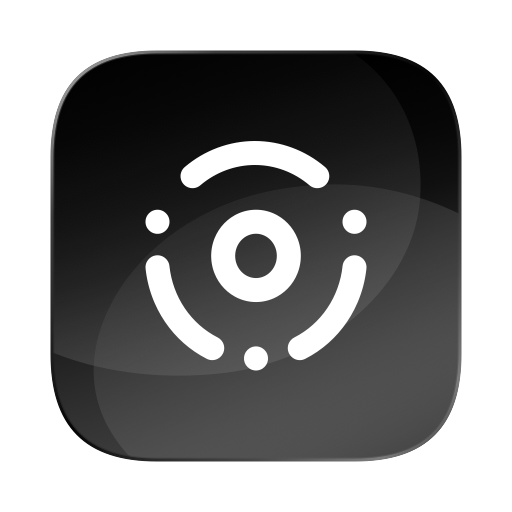

<div align="center">
  
  <h1>TapKeys</h1>
  <p><b>Free and open source trackpad gestures for macOS.</b><br>For people who only need a few BetterTouchTool triggers, such as double tap to copy and three-finger click to paste.</p>
  <p><b>English</b> · <a href="README.ru.md">Русский</a></p>
  <p>
    <a href="https://github.com/scharfff/tapkeys/releases/latest"></a>
    <a href="https://github.com/scharfff/tapkeys/actions/workflows/ci.yml"></a>
    <a href="LICENSE"></a>
    
    <a href="https://github.com/scharfff/tapkeys/releases"></a>
  </p>
</div>

TapKeys runs in the menu bar and turns trackpad gestures into keyboard shortcuts.

| Gesture | Default action |
|---|---|
| Double tap with one finger | Copy (⌘C) |
| Click with three fingers | Paste (⌘V) |
| Tap with three fingers | none |
| Tap with four fingers | none |
| Click with four fingers | none |

You can bind any gesture to copy, paste, cut, undo, redo, select all, a middle click, or a keyboard shortcut you record. The bindings are in **Settings…** in the menu bar menu (⌘, works while the menu is open). The menu also has an **Enabled** switch to pause the gestures. Launch at login, the timing sliders and Reset to Defaults are in Settings, on the General tab.

## Install

With [Homebrew](https://brew.sh):

```bash
brew install --cask scharfff/tap/tapkeys
```

To install by hand, download `TapKeys-vX.Y.Z.zip` from [Releases](https://github.com/scharfff/tapkeys/releases), unzip it and move `TapKeys.app` to `/Applications`. Each release also has a DMG, `TapKeys-X.Y.Z.dmg`. Open it and drag TapKeys to Applications.

TapKeys needs macOS 13 or newer. The build is universal, so it runs on Apple Silicon and Intel.

### First launch

TapKeys is signed ad hoc and not notarized, so macOS blocks it the first time:

- On macOS 15 or newer, open the app once, then click **Open Anyway** in System Settings → Privacy & Security.
- On macOS 13 and 14, right-click `TapKeys.app` and choose **Open**, then **Open** again.
- On any version, you can clear the quarantine flag from Terminal:
  ```bash
  xattr -dr com.apple.quarantine /Applications/TapKeys.app
  ```

### Accessibility access

Allow access when macOS asks, or turn it on in System Settings → Privacy & Security → Accessibility. TapKeys needs it to replace a click with a shortcut. Because the app is signed ad hoc, macOS drops this permission after every update; remove the old TapKeys entry from the list and enable the new one.

### If the menu bar icon is missing

TapKeys opens its Settings window on the first launch. After that, menu bar managers such as Ice and Bartender, and the notch on some displays, can hide the icon. Open TapKeys again from Finder, Spotlight or Launchpad and the Settings window appears.

### Build from source

You need the Xcode Command Line Tools (`xcode-select --install`).

```bash
git clone https://github.com/scharfff/tapkeys.git
cd tapkeys
./build.sh
open build/TapKeys.app
```

macOS treats every local rebuild as a new app because of the ad hoc signature, so you have to grant Accessibility access again after each one.

## Recommended trackpad settings

A gesture that macOS already uses will fire twice. Check these in System Settings → Trackpad (the General tab in TapKeys opens it):

- Turn off **Tap to click** if you use the one-finger double tap. Otherwise the same taps also make a double click.
- Turn off **Look up & data detectors** with three fingers if you bind the three-finger tap.
- Turn off **Three-finger drag** (Accessibility → Pointer Control) if you bind the three-finger click.

If BetterTouchTool is installed, quit it or disable its matching triggers.

## How it works

- Touches come from Apple's private `MultitouchSupport.framework`, which TapKeys loads at runtime with `dlsym`. A contact counts as a tap if it is shorter than the tap length (0.25 s by default) and the centroid of the fingers moves less than the allowed movement (3% of the trackpad width). Two one-finger taps within the double tap gap (0.35 s) make a double tap.
- Clicks come from a `CGEvent` tap. If three or four fingers rest on the trackpad and that click has a binding, TapKeys swallows the click and runs the action. It never touches one- and two-finger clicks.
- Letter shortcuts follow the current keyboard layout, so ⌘C stays ⌘C on AZERTY, Dvorak or a Russian layout. Other recorded keys are sent by their key code.
- Settings live in `UserDefaults` under `io.github.scharfff.tapkeys`.

`--selftest` prints the number of trackpads, whether Accessibility access is granted, and the current bindings:

```bash
/Applications/TapKeys.app/Contents/MacOS/TapKeys --selftest
```

## Project layout

| Path | What |
|---|---|
| `Sources/Engine.swift` | touch recognition, click interception, actions |
| `Sources/Preferences.swift` | gestures, actions, bindings and their storage |
| `Sources/SettingsView.swift` | SwiftUI settings window |
| `Sources/main.swift` | menu bar item and app entry point |
| `scripts/make_icon.swift` | renders `Resources/AppIcon.svg` into `Resources/AppIcon.icns` and `docs/icon.png` |
| `scripts/make_dmg.sh` | builds `build/TapKeys-X.Y.Z.dmg` |
| `scripts/make_dmg_background.swift` | renders the DMG window background in `Resources/` |
| `scripts/package.sh` | builds the zip, the DMG and `SHA256SUMS` for a release |
| `scripts/smoke_test.sh` | checks a built package: signature, both architectures, self-test from the DMG |
| `scripts/changelog_notes.sh` | extracts the release notes for a version from `CHANGELOG.md` |
| `.github/workflows/ci.yml` | build and checks on every push and pull request |
| `.github/workflows/release.yml` | draft, check and publish a release on `v*` tags, then update the Homebrew cask |

## Limitations

TapKeys relies on private APIs, which can change between macOS releases. It has been tested on macOS 15 (Intel).

## License

MIT © 2026 Scharf L.
