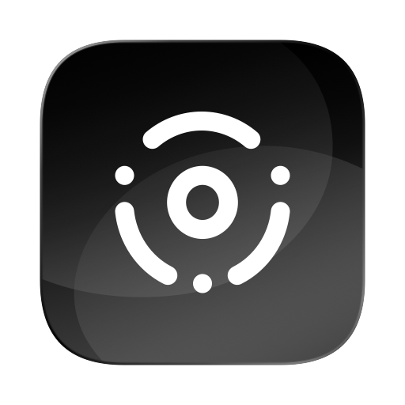

<div align="center">
  
  <h1>TapKeys</h1>
  <p><b>Бесплатные жесты трекпада для macOS с открытым кодом.</b><br>Для тех, кому от BetterTouchTool нужно всего несколько триггеров: двойной тап для копирования, клик тремя пальцами для вставки.</p>
  <p><a href="README.md">English</a> · <b>Русский</b></p>
  <p>
    <a href="https://github.com/scharfff/tapkeys/releases/latest"></a>
    <a href="https://github.com/scharfff/tapkeys/actions/workflows/ci.yml"></a>
    <a href="LICENSE"></a>
    
    <a href="https://github.com/scharfff/tapkeys/releases"></a>
  </p>
</div>

TapKeys работает в строке меню и превращает жесты трекпада в сочетания клавиш.

| Жест | Действие по умолчанию |
|---|---|
| Двойной тап одним пальцем | Copy (Скопировать), ⌘C |
| Клик тремя пальцами | Paste (Вставить), ⌘V |
| Тап тремя пальцами | Nothing (ничего) |
| Тап четырьмя пальцами | Nothing |
| Клик четырьмя пальцами | Nothing |

Любому жесту можно назначить Copy, Paste, Cut (Вырезать), Undo (Отменить), Redo (Повторить), Select all (Выбрать всё), Middle click (Средний клик) или Custom shortcut… (Своё сочетание клавиш). Назначения задаются в **Settings…** (Настройки…) из меню значка в строке меню (пока меню открыто, работает ⌘,). В меню есть и переключатель **Enabled** (Включено), он ставит жесты на паузу. Переключатель **Launch at login** (Запуск при входе), ползунки в секции Timing (Время) и кнопка **Reset to Defaults** (Сбросить) находятся в Settings, на вкладке General (Основные).

## Установка

Через [Homebrew](https://brew.sh):

```bash
brew install --cask scharfff/tap/tapkeys
```

Вручную: скачайте `TapKeys-vX.Y.Z.zip` со страницы [Releases](https://github.com/scharfff/tapkeys/releases), распакуйте и перенесите `TapKeys.app` в `/Applications`. В каждом релизе есть и DMG, `TapKeys-X.Y.Z.dmg`. Откройте его и перетащите TapKeys в «Программы».

Нужна macOS 13 или новее. Сборка универсальная, работает на Apple Silicon и Intel.

### Первый запуск

TapKeys подписан ad hoc и не нотаризован, поэтому в первый раз macOS его блокирует:

- В macOS 15 и новее откройте приложение один раз, затем нажмите **Всё равно открыть** в разделе «Системные настройки» → «Конфиденциальность и безопасность».
- В macOS 13 и 14 нажмите на `TapKeys.app` правой кнопкой, выберите **Открыть** и ещё раз **Открыть**.
- В любой версии можно снять карантин через Терминал:
  ```bash
  xattr -dr com.apple.quarantine /Applications/TapKeys.app
  ```

### Универсальный доступ

Разрешите доступ, когда macOS спросит, или включите его в разделе «Системные настройки» → «Конфиденциальность и безопасность» → «Универсальный доступ». Без него TapKeys не сможет заменить клик сочетанием клавиш. Из-за подписи ad hoc macOS сбрасывает это разрешение после каждого обновления: удалите старую запись TapKeys из списка и включите новую.

### Если значка в строке меню не видно

При первом запуске TapKeys сам открывает окно настроек. Позже значок могут спрятать менеджеры строки меню вроде Ice и Bartender или вырез экрана. Откройте TapKeys ещё раз из Finder, Spotlight или Launchpad, и окно настроек появится.

### Сборка из исходников

Нужны Xcode Command Line Tools (`xcode-select --install`).

```bash
git clone https://github.com/scharfff/tapkeys.git
cd tapkeys
./build.sh
open build/TapKeys.app
```

Из-за подписи ad hoc macOS считает каждую локальную пересборку новым приложением, поэтому доступ в «Универсальном доступе» после неё придётся выдать заново.

## Рекомендуемые настройки трекпада

Жест, который macOS уже использует, сработает дважды. Проверьте эти пункты в разделе «Системные настройки» → «Трекпад» (его открывает кнопка **Open Trackpad Settings** (Открыть настройки трекпада) на вкладке General в TapKeys):

- Выключите **Имитацию нажатия касанием**, если пользуетесь двойным тапом одним пальцем. Иначе те же касания дадут ещё и двойной клик.
- Выключите **Поиск и детекторы данных** тремя пальцами, если назначили тап тремя пальцами.
- Выключите **Перетаскивание тремя пальцами** («Универсальный доступ» → «Управление курсором»), если назначили клик тремя пальцами.

Если установлен BetterTouchTool, закройте его или отключите в нём такие же триггеры.

## Как это работает

- Касания приходят из закрытого фреймворка Apple `MultitouchSupport.framework`, который TapKeys загружает во время работы через `dlsym`. Касание считается тапом, если оно короче длины тапа (по умолчанию 0,25 с) и центр пальцев сдвигается меньше допустимого (3% ширины трекпада). Два тапа одним пальцем с промежутком не больше интервала двойного тапа (0,35 с) дают двойной тап.
- Клики приходят через перехватчик событий `CGEvent` (event tap). Если на трекпаде лежат три или четыре пальца и у такого клика есть назначение, TapKeys перехватывает клик и выполняет действие. Клики одним и двумя пальцами он не трогает.
- Буквенные сочетания подстраиваются под текущую раскладку, поэтому ⌘C остаётся ⌘C на AZERTY, Dvorak и русской раскладке. Остальные записанные клавиши отправляются по коду клавиши.
- Настройки хранятся в `UserDefaults` под именем `io.github.scharfff.tapkeys`.

`--selftest` выводит число трекпадов, есть ли разрешение в «Универсальном доступе» и текущие назначения:

```bash
/Applications/TapKeys.app/Contents/MacOS/TapKeys --selftest
```

## Структура проекта

| Путь | Что |
|---|---|
| `Sources/Engine.swift` | распознавание касаний, перехват кликов, действия |
| `Sources/Preferences.swift` | жесты, действия, назначения и их хранение |
| `Sources/SettingsView.swift` | окно настроек на SwiftUI |
| `Sources/main.swift` | значок в строке меню и точка входа |
| `scripts/make_icon.swift` | рендерит `Resources/AppIcon.svg` в `Resources/AppIcon.icns` и `docs/icon.png` |
| `scripts/make_dmg.sh` | собирает `build/TapKeys-X.Y.Z.dmg` |
| `scripts/make_dmg_background.swift` | рисует фон окна DMG в `Resources/` |
| `scripts/package.sh` | собирает zip, DMG и `SHA256SUMS` для релиза |
| `scripts/smoke_test.sh` | проверяет готовый пакет: подпись, обе архитектуры, самотест из DMG |
| `scripts/changelog_notes.sh` | достаёт заметки к версии из `CHANGELOG.md` |
| `.github/workflows/ci.yml` | сборка и проверки при каждом push и pull request |
| `.github/workflows/release.yml` | черновик, проверка и публикация релиза по тегам `v*`, затем обновление формулы Homebrew |

## Ограничения

TapKeys опирается на закрытые API, а они могут меняться между версиями macOS. Проверено на macOS 15 (Intel).

## Лицензия

MIT © 2026 Scharf L.
